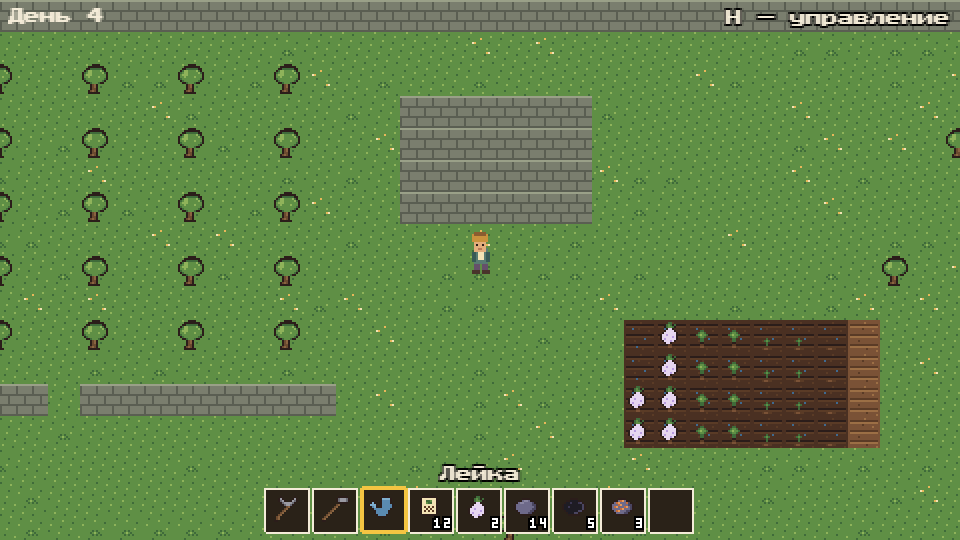
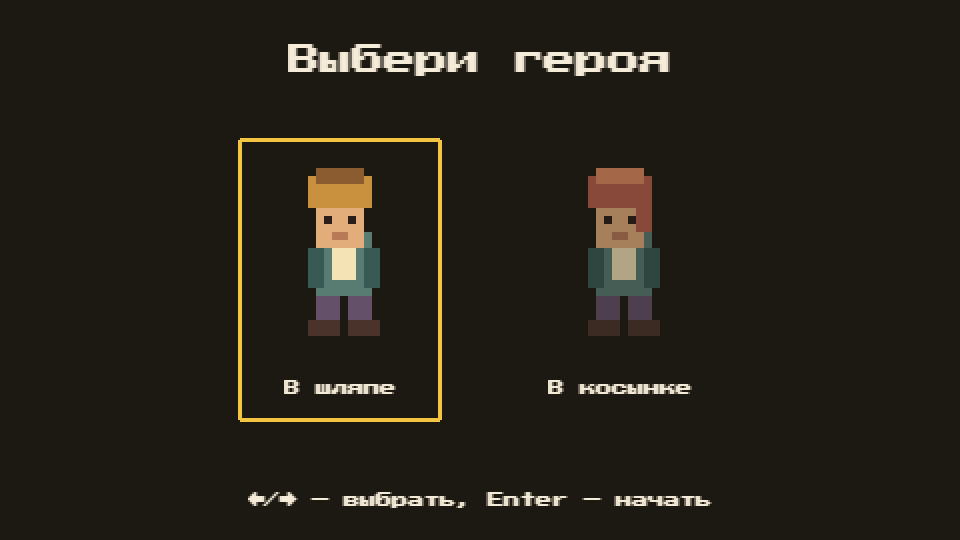
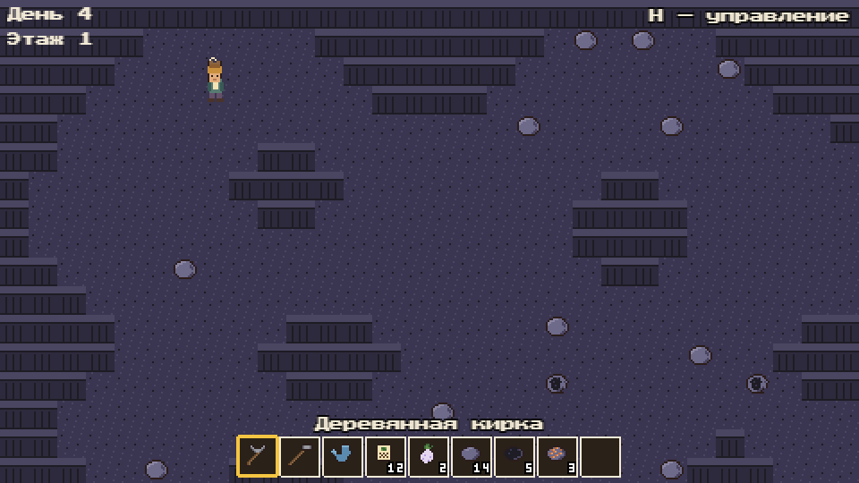
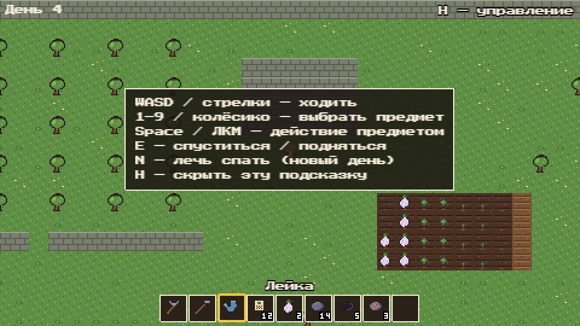

# Under the Orchard

Уютная 2D-игра с видом сверху: на поверхности — ферма и фруктовый сад, под садом — шахта из этажей. Жанр — фермерская игра, но мир, персонажи и пиксель-арт свои.

Сейчас в репозитории — **быстрый веб-прототип** (ветка `prototype`). Его цель — проверить, приятно ли копать и сажать. Полная версия планируется на Godot 4.



## Что уже есть

- **Выбор героя** перед началом игры.
- **Сад:** свободная ходьба с диагональю, столкновения, камера.
- **Грядка:** вскопать мотыгой → посадить семя → полить лейкой → лечь спать (новый день) → собрать спелую репу в инвентарь. Растёт только политое.
- **Шахта:** вход в саду, этажи генерируются случайно. Камни разбиваются киркой, добыча (камень, уголь, медь с 5-го этажа) падает в хотбар, под одним из камней — лестница вниз.
- **Хотбар** на 9 слотов, предметы складываются в стопки.
- Отклик от действий: комья земли, брызги, крошка камня, синтезированные звуки.

| Выбор героя | Шахта |
|---|---|
|  |  |

## Управление

| Клавиша | Действие |
|---|---|
| `WASD` / стрелки | Ходить |
| `1`–`9` / колёсико | Выбрать предмет в хотбаре |
| `Space` / ЛКМ | Действие предметом в руке (копать, сажать, поливать, бить камень, собирать урожай) |
| `E` | Спуститься в шахту / подняться по лестнице |
| `N` | Лечь спать — наступает новый день |
| `H` | Показать / скрыть подсказку по управлению |



## Как запустить

Нужен только [Docker](https://www.docker.com/) — Node.js ставить на компьютер не надо, он работает в контейнере.

```bash
docker compose up
```

Затем открыть <http://localhost:5173>. Изменения в коде подхватываются сами.

Тесты, проверка типов и сборка (при запущенном `docker compose up`):

```bash
docker compose exec dev npm test
```

```bash
docker compose exec dev npm run typecheck
```

```bash
docker compose exec dev npm run build
```

## Стек

TypeScript, [Phaser 3](https://phaser.io/) (Arcade Physics), Vite, Vitest. Окружение — Docker.

## Устройство кода

```
src/
  logic/     чистые правила игры без Phaser: карта, инвентарь, ферма, шахта (покрыты тестами)
  data/      данные: предметы, растения, правила шахты, ASCII-карты
  objects/   игровые объекты и помощники: игрок, тайлмап, эффекты, звуки, шрифты
  scenes/    сцены Phaser: Boot, выбор героя, сад, шахта, интерфейс
  state.ts   общее состояние игры и события
public/assets/   пиксель-арт (спрайты, тайлы, иконки) и шрифт
docs/            дизайн, архитектура, бриф по ассетам, скриншоты
```

Подробнее: [дизайн-документ](docs/GAME_DESIGN.md), [архитектура](docs/ARCHITECTURE.md), [бриф по ассетам](docs/ASSET_BRIEF.md).

## Ассеты

Пиксель-арт нарисован для этого проекта. Шрифт [Press Start 2P](https://fonts.google.com/specimen/Press+Start+2P) распространяется по лицензии SIL Open Font License 1.1 (`public/assets/fonts/OFL.txt`). Звуки синтезируются в браузере, аудиофайлов нет.
